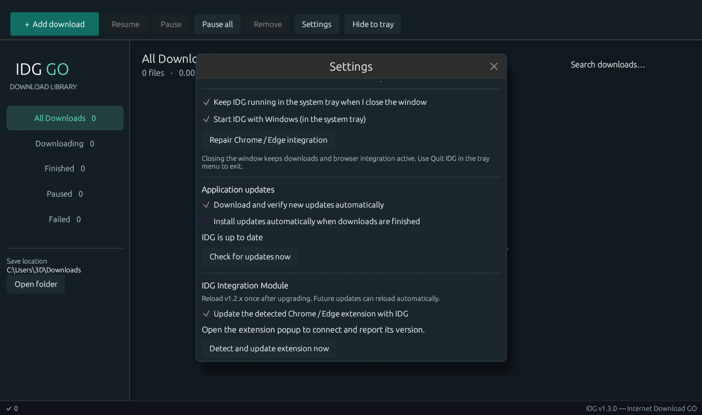
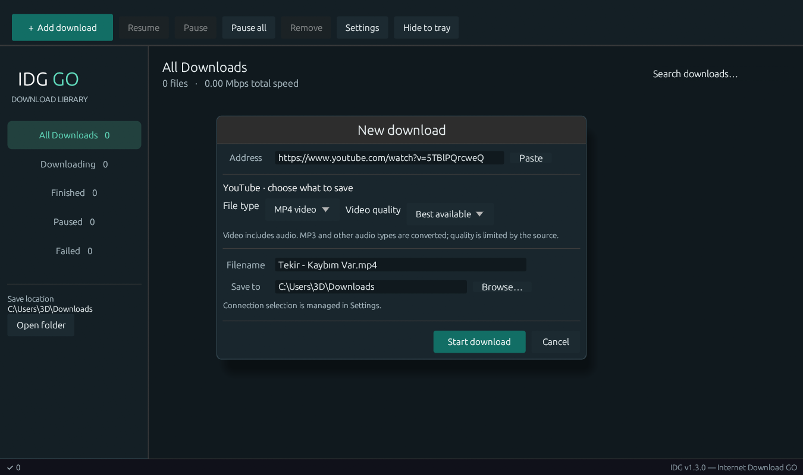

<div align="center">

<br/>


# IDG — Internet Download GO

**A fast, lightweight download manager for Windows.**  
Splits every file into multiple parallel connections — just like IDM, but free and open source.

<br/>

[](https://github.com/Mustafa1p/IDG-internet-download-go/actions)
[](https://github.com/Mustafa1p/IDG-internet-download-go/releases/latest)
[](LICENSE)
[](https://github.com/Mustafa1p/IDG-internet-download-go/releases/latest)

<br/>

## ⬇️ Download

<a href="https://github.com/Mustafa1p/IDG-internet-download-go/releases/latest/download/IDG-Setup-v1.3.0.exe">
  
</a>
&nbsp;&nbsp;
<a href="https://github.com/Mustafa1p/IDG-internet-download-go/releases/latest/download/IDG-extension-v1.3.0.zip">
  
</a>

<br/><br/>

> **No registration. No ads. No limits.**

<br/>

</div>

---

## 📸 Screenshot


---

## ✨ What is IDG?

**IDG (Internet Download GO)** is a free and open-source download manager for Windows.

It works the same way as **IDM (Internet Download Manager)** — it splits every download into multiple parallel connections and downloads all parts at the same time. This makes downloads **3–10× faster** than a regular single-connection download.

| Feature | IDG | Regular Browser |
|---|---|---|
| Parallel segments | ✅ Up to 32 | ❌ 1 |
| Pause & Resume | ✅ | ❌ |
| Browser integration | ✅ Chrome & Edge | — |
| Auto filename detect | ✅ | ❌ |
| Cost | **Free** | — |

---

## 🚀 How to install

### Step 1 — Download the installer

👉 **[Download IDG-Setup-v1.3.0.exe](https://github.com/Mustafa1p/IDG-internet-download-go/releases/latest/download/IDG-Setup-v1.3.0.exe)**

### Step 2 — Run the installer

Double-click the downloaded file and follow the wizard:

```
1. Click "Next"
2. Choose install folder  (default: C:\Program Files\IDG)
3. Check "Create Desktop shortcut" if you want one
4. Click "Install"
5. IDG opens automatically when done ✅
```

### Step 3 — Start downloading

- Click **⬇ Add URL** in the toolbar
- Paste any direct download link
- Click **OK** — IDG downloads it with multiple parallel connections

---

## 🔌 How to install the browser extension

**IDG Integration Module** lets IDG automatically intercept downloads from Chrome and Edge.

### Step 1 — Download the extension

👉 **[Download IDG-extension-v1.3.0.zip](https://github.com/Mustafa1p/IDG-internet-download-go/releases/latest/download/IDG-extension-v1.3.0.zip)**

### Step 2 — Extract the ZIP

Right-click the downloaded `.zip` → **Extract All** → remember the folder location.

### Step 3 — Load in Chrome or Edge

1. Open Chrome → address bar → type `chrome://extensions` → Enter
2. Toggle **Developer mode** ON (top-right corner)
3. Click **Load unpacked**
4. Select the extracted folder
5. The IDG icon appears in your browser toolbar ✅

### Step 4 — Test it

Use the updated installer, then remove the old extension and load the new `extension` folder in `chrome://extensions` (or `edge://extensions`). This update gives unpacked installs a stable ID: `blmjnmockbofpnipcniflmalfmiaolcj`.

Open the extension popup: **IDG is connected** means the desktop app is running; **IDG is ready** means the native host is installed and can launch it. Click a direct file download. IDG opens a confirmation window where you can edit the filename, choose a save folder, and click **Start download**. Multiple requests are shown one at a time. Cancel discards that request.

If IDG cannot accept a request, the original browser download resumes. YouTube watch pages and Shorts are sent to the bundled video downloader, including players that use blob URLs. Generic blob streams, protected media, and downloads Chrome cannot pause remain in the browser.

For source builds or portable integration, keep `IDG.exe` and `IDG-native.exe` together and run:

```powershell
cargo build --release --bins
.\installer\register-native-host.ps1
```

The registration script and installer register the native host for the current Windows user in Chrome and Edge. If Chrome says the native host is missing, rerun the installer or registration script under your browser's Windows account, then reload the extension. A portable EXE alone can receive downloads while open, but requires the bridge and registration for automatic launch.

The extension declares access to all websites, downloads, extension/app/theme management, and native messaging. Website access reads download cookies and adds direct-media buttons. No app or extension is enabled, disabled, or removed by IDG.

Transfer rates use **Mbps** (decimal megabits per second), with 8 bits per byte; file sizes remain in bytes. `Mbps/s` would be a rate of change, so the UI uses `Mbps`.

> **Tip:** Right-click any link or image → **Download with IDG**

---

## 🎯 Features

- **Automatic parallel downloads** — chooses up to 32 connections from file size and verified server support; manual counts are available in Settings
- **Pause & Resume** — stop and continue any download at any time
- **Auto filename** — automatically reads the correct filename from the server
- **Browser extension** — intercepts downloads from Chrome and Edge
- **Right-click menu** — right-click any link → "Download with IDG"
- **Live speed & ETA** — see real-time download speed and estimated time
- **Category filter** — view All / Downloading / Finished / Paused / Failed
- **Dark compact UI** — clean, minimal interface
- **Portable or installed** — complete portable ZIP or installer, including the native bridge and media tools
- **Free & open source** — MIT license

---

## YouTube downloads

Install the **complete v1.3.0 package** and reload **IDG Integration Module**. Quit any older IDG through its tray menu first. Opening the new app repairs Chrome/Edge native-host registration for your Windows account; Settings also has **Repair Chrome / Edge integration**.

Open a YouTube video and click **Download with IDG** over the player, or **Download this YouTube video** in the extension popup. You can also paste a watch/Shorts/youtu.be link into IDG. Radio and playlist parameters are removed so the selected video is downloaded once. IDG saves an MP4 with video and audio using the bundled yt-dlp, FFmpeg, and Deno tools. Larger formats are downloaded and merged automatically. Cancel through **Remove**; pause/resume is available for regular direct-file downloads.

The media tools are pinned and checksum-verified at build time. Their licenses, versions, and source locations are included in `tools/licenses`. Keep the `tools` folder beside `IDG.exe` for portable use. A standalone EXE alone cannot download YouTube videos. Some videos may require an authenticated session or be unavailable; the extension passes the selected site's cookies in a temporary file that is removed when the media job ends. Errors now explain missing registration or an outdated app instead of only showing “IDG unavailable”.

## Automatic parallel connections

Downloads use **Automatic** mode by default. IDG verifies that the server accepts byte ranges, then chooses up to 32 connections, allowing at least 2 MiB per segment. Larger files use more connections; small files, unknown-size streams, and servers without working range support use one connection. The table shows the actual count after connecting.

To choose a count yourself, open **Settings → Parallel connections → Manual**, enter a number from **1 to 32**, and click **Save**. Choose **Automatic (recommended)** to restore automatic selection. Settings persist across restarts and apply to new desktop and browser downloads. The download confirmation window has no connection slider. Connection counts cannot guarantee a particular speed; the server and network determine the available throughput.

## System tray and automatic startup

IDG keeps downloads and browser integration running when you close its window. Its icon stays in the Windows notification area (system tray), possibly inside the **^** hidden-icons menu.

- Click the tray icon, or right-click it and choose **Open IDG**, to reopen the window.
- Choose **Quit IDG** in the tray menu to stop the app.
- **Settings → Start IDG with Windows** enables or disables startup for your Windows account. It opens in the tray at sign-in.
- **Settings → Keep IDG running in the system tray** controls what the window's close button does.
- Opening IDG again reopens the existing instance. Browser download requests also bring the confirmation window forward.

The installer's **Start IDG when Windows starts** option is selected by default. Portable copies can enable startup through Settings; keep the app in its chosen folder afterward. If creating the tray icon fails, IDG keeps its window accessible and closing it exits normally.

## 🏗️ Build from source

```powershell
# Requirements: Rust stable (edition 2024) and Visual Studio Build Tools 2022

git clone https://github.com/Mustafa1p/IDG-internet-download-go.git
cd IDG-internet-download-go

cargo build --release
# Output: target\release\IDG.exe
```

### Package portable app and extension

```powershell
python installer/fetch-media-tools.py
python installer/package.py
# dist/IDG-portable-v1.3.0.zip and dist/IDG-extension-v1.3.0.zip
```

Extract the portable ZIP, run `installer/register-native-host.ps1` from PowerShell, and load its `extension` folder in Chrome or Edge. Keep `IDG.exe` and `IDG-native.exe` together.

### Build the Windows installer

```powershell
.\installer\build-installer.ps1
# → dist\IDG-Setup-v1.3.0.exe
# (downloads Inno Setup automatically if not installed)
```

---

## 🤝 Contributing

Pull requests are welcome! Please read [CONTRIBUTING.md](CONTRIBUTING.md) first.

```powershell
cargo fmt
cargo clippy
cargo build --release
```

---

## 📄 License

[MIT](LICENSE) © 2026 [mustafa1p](https://github.com/Mustafa1p)

The loopback API uses `127.0.0.1:17843`. Both app and extension must be updated together. If the port is occupied, IDG shows the browser integration error in its window.

## Verification

```powershell
cargo fmt --check
cargo clippy --all-targets -- -D warnings
cargo test --bins
node --test tests/extension.test.cjs
# With IDG closed, verify the real native bridge and app:
python tests/native-smoke.py
# On an interactive Windows desktop, with IDG closed:
python tests/tray-smoke.py
```

Automated tests exercise handoff success/failure, native framing, stable extension identity, saved interception settings, API confirmation, and exact bytes for authenticated parallel downloads. To verify Chrome installation end to end, install the current build, load the extension, close IDG, and download a direct ZIP link. Confirm that IDG opens with an editable filename, then start it and compare the result with the source. Disable capture in the popup and check that Chrome handles the next download itself.

## Updates, YouTube choices, and Windows startup (v1.3.0)

Open **Settings → Application updates** to check for a new release, automatically download and verify it, or enable automatic installation when all downloads are finished. **Install update and restart IDG** replaces the complete app in its current folder and reopens it. Finish or remove queued/paused transfers first. No browser download or manual installer search is needed after installing v1.3.0 once. Windows can still request elevation for a protected installation folder.

The updater verifies the installer size and SHA-256 digest published by GitHub. An interrupted or altered download is rejected, with a retry option. Update checks run at launch and every six hours while the UI is active.

**Settings → IDG Integration Module** detects the existing unpacked extension in Chrome/Edge profiles, updates only IDG's own files, and lets the extension reload itself. Browser preferences are read without modification. If detection misses a custom profile, select the existing extension folder once. After migrating from v1.2.x, reload the extension once in `chrome://extensions` or `edge://extensions` and refresh open YouTube pages. Future unpacked updates can reload automatically; store-managed extensions remain managed by the browser.

YouTube links open **New download** before transferring media. Choose MP4, MKV, or WebM video and **Best available** or a maximum resolution. IDG checks the video's available qualities. For audio choose MP3, M4A, Opus, WAV, or FLAC; compressed formats offer bitrate choices. Conversion cannot improve the original source quality.






Windows startup is enabled by default by the installer and on the first portable run. IDG starts in the system tray; the setting remains editable. The app, installer, shortcuts, and taskbar use the embedded IDG icon. If an old pinned shortcut retains Windows' cached generic icon, unpin it and pin the updated IDG once.
