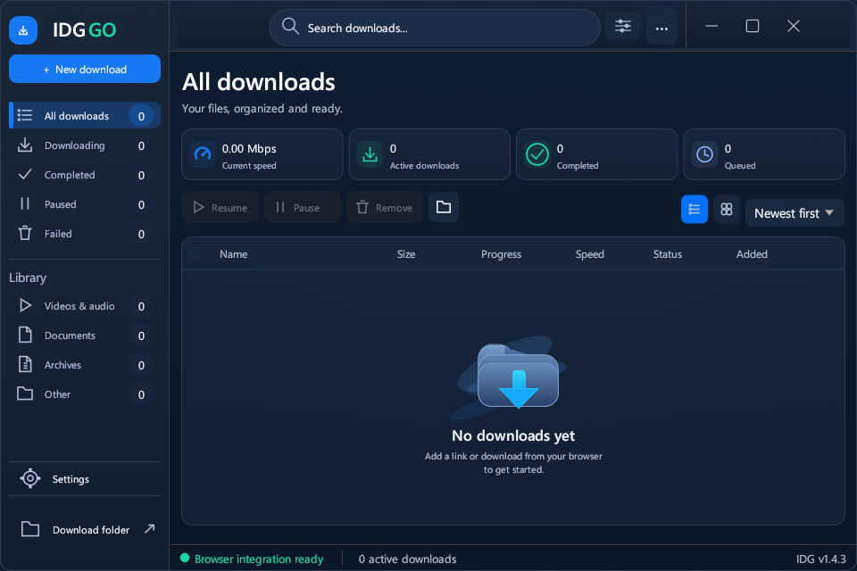
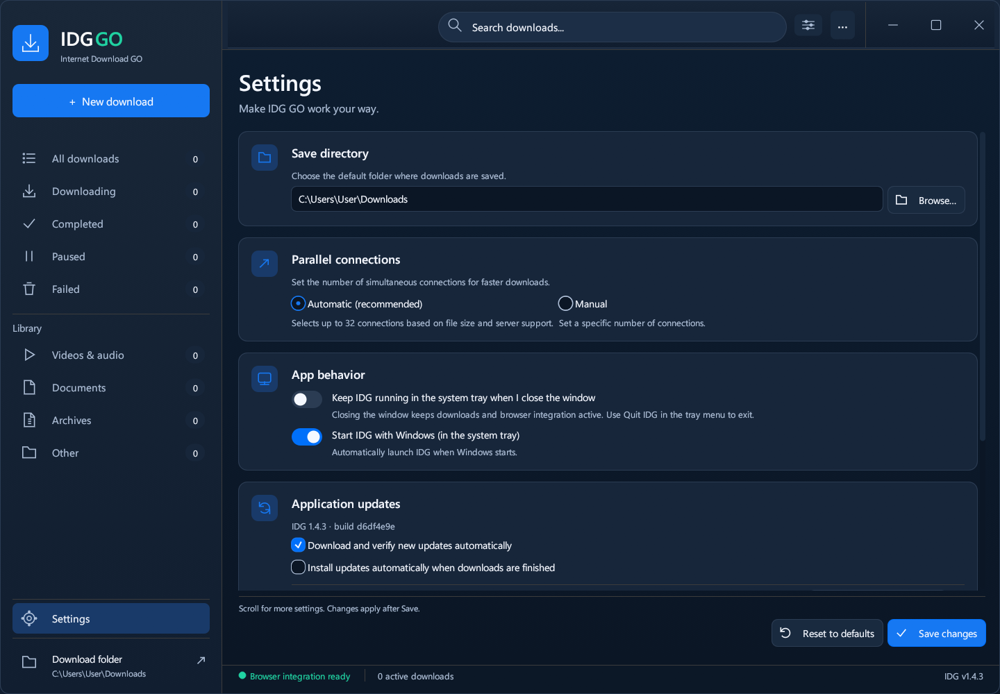

<div align="center">

<br/>


# IDG — Internet Download GO

**A Rust download manager with a Windows 11 Fluent-style desktop interface.**
Developed by **Mustafa Ali**. Supports multiple parallel connections — just like IDM, but free and open source.

<br/>

[](https://github.com/Mustafa1p/IDG-internet-download-go/actions)
[](https://github.com/Mustafa1p/IDG-internet-download-go/releases/latest)
[](LICENSE)
[](https://github.com/Mustafa1p/IDG-internet-download-go/releases/latest)

<br/>

## ⬇️ Download

<a href="https://github.com/Mustafa1p/IDG-internet-download-go/releases/latest/download/IDG-Setup-v1.4.8.exe">
  
</a>
&nbsp;&nbsp;
<a href="https://github.com/Mustafa1p/IDG-internet-download-go/releases/latest/download/IDG-extension-v1.4.8.zip">
  
</a>

<br/><br/>

> **No registration. No ads. No limits.**

<br/>

</div>

---

## Original-service music preview

Version **[1.5.1 preview](https://github.com/Mustafa1p/IDG-internet-download-go/releases/tag/v1.5.1)** adds **Settings > Music**, with IDG Music Accounts and an optional internal music backend for Spotify, Bandcamp, Apple Music, Deezer, Qobuz and Tidal. Spotify Desktop shows the pairing device as **IDG**. Install the optional backend and connect the relevant account before downloading. It uses the original service and does not substitute YouTube search results. Bandcamp has passed a live download through IDG; authenticated Spotify and the other subscription services remain unverified until an account is connected. This preview is not offered automatically to stable users.

The separate music worker is GPL-2.0 licensed; IDG's Rust application remains MIT licensed. See [music setup, verification and limitations](docs/music-backend.md). The existing **1.4.8 stable** downloads below remain available.

## Current desktop

Windows setup: [**x64 (64-bit)**](https://github.com/Mustafa1p/IDG-internet-download-go/releases/download/v1.4.8/IDG-Setup-v1.4.8.exe) | [**x86 (32-bit)**](https://github.com/Mustafa1p/IDG-internet-download-go/releases/download/v1.4.8/IDG-Setup-v1.4.8-x86.exe).



The refreshed **v1.4.8** interface is implemented directly in Rust/egui: blue sidebar navigation, search and filters, four live statistics, list/grid views, selection checkboxes, and a consistent Settings and download-dialog design. The screenshot above is captured from the current desktop application.

| Desktop workflow | Where to find it |
| --- | --- |
| New transfer | **New download** or **Ctrl+N** |
| Search and filter | Header search (**Ctrl+F**), sliders menu, or any sidebar category |
| Bulk actions | Select row checkboxes or the header checkbox; Resume, Pause, Remove, Open folder |
| Views and sorting | List/grid controls and Newest first / Oldest first above the table |
| Settings | Sidebar **Settings** or **Ctrl+,**; save folder, connections, browser integration, startup/tray and updates |
| New versions | Update popup and banner with release fixes, progress, Update now, Install and Later |

See the [complete UI and integration route map](docs/ui-navigation.md) and [verification report](docs/fluent-qa.md) and [implementation comparison](docs/fluent-redesign-report.md). At smaller window sizes, statistics and details become compact while the same actions remain available. The normal window starts at 960 x 640 logical points, respects Windows display scaling, and supports resizing and maximize; saved preferences and user files are preserved. Version **1.4.8** adds compact Settings tabs, an optional per-download speed limit (Unlimited by default), bounded speed sampling and batched file writes. It also detects PHP download endpoints when the browser resolves their filename or MIME type later, preserves token-bearing POST downloads from Adsume/SafeFileHosting and equivalent hidden download forms on other sites, and supports direct links on dynamically inserted `button_dm` download buttons. Token downloads stream once without parallel token replays. Chrome/Edge 111 or newer is required. Update the extension and reload existing website tabs after installation.

---

## ✨ What is IDG?

**IDG (Internet Download GO)** is a free and open-source download manager for Windows.

It works the same way as **IDM (Internet Download Manager)** — it splits every download into multiple parallel connections and downloads all parts at the same time. Parallel connections can improve throughput when the server supports byte ranges; actual speed depends on the source and connection.

| Feature | IDG | Regular Browser |
|---|---|---|
| Parallel segments | ✅ Up to 32 | ❌ 1 |
| Pause & Resume | ✅ | ❌ |
| Browser integration | ✅ Chrome & Edge | — |
| Auto filename detect | ✅ | ❌ |
| Cost | **Free** | — |

---

## 🚀 How to install

### Step 1 — Download the installer

Choose [**x64 setup (64-bit)**](https://github.com/Mustafa1p/IDG-internet-download-go/releases/download/v1.4.8/IDG-Setup-v1.4.8.exe) or [**x86 setup (32-bit)**](https://github.com/Mustafa1p/IDG-internet-download-go/releases/download/v1.4.8/IDG-Setup-v1.4.8-x86.exe).

### Step 2 — Run the installer

**Windows publisher warning:** The v1.4.8 downloads are unsigned and may
trigger “Windows protected your PC” (SmartScreen) or a Smart App Control block.
Trusted signing requires a verified publisher identity. Release signing support
is implemented, but a signed release has not yet been published. See
[Windows signing and release setup](docs/windows-signing.md) for status and setup.

Double-click the downloaded file and follow the wizard:

```
1. Click "Next"
2. Choose install folder  (default: C:\Program Files\IDG)
3. Check "Create Desktop shortcut" if you want one
4. Click "Install"
5. IDG opens automatically when done ✅
```

### Step 3 — Start downloading

- Click **New download** in the sidebar, or press **Ctrl+N**
- Paste a direct download link and review the filename and save folder
- Click **Start download** — IDG uses its existing connection policy

---

## 🔌 How to install the browser extension

**IDG Integration Module** lets IDG automatically intercept downloads from Chrome and Edge.

Hostinger Mail exports are supported: one message downloads as `.eml`, and multiple
selected messages download as the ZIP supplied by Hostinger (containing `.eml` files).
Start the export from your signed-in Hostinger Mail tab with the IDG extension enabled
so it can pass the export's session credentials. Pasting the URL alone may fail if it
requires authentication. Generated exports use one streaming connection; if interrupted,
start a fresh export from Mail.

### Step 1 — Download the extension

👉 **[Download IDG-extension-v1.4.8.zip](https://github.com/Mustafa1p/IDG-internet-download-go/releases/latest/download/IDG-extension-v1.4.8.zip)**

### Step 2 — Extract the ZIP

Right-click the downloaded `.zip` → **Extract All** → remember the folder location.

### Step 3 — Load in Chrome or Edge

1. Open Chrome → address bar → type `chrome://extensions` → Enter
2. Toggle **Developer mode** ON (top-right corner)
3. Click **Load unpacked**
4. Select the extracted folder
5. The IDG icon appears in your browser toolbar ✅

### Step 4 — Test it

Use the updated installer, then remove the old extension and load the new `extension` folder in `chrome://extensions` (or `edge://extensions`). This update gives unpacked installs a stable ID: `blmjnmockbofpnipcniflmalfmiaolcj`.

Open the extension popup to see **IDG is connected**, **IDG is ready**, or **IDG is not connected**. The popup only reports connection status. Browser downloads are forwarded automatically; use the page's YouTube download overlay or the browser context menu for media links. Confirm filenames, formats, and save locations in the desktop app.

If IDG cannot accept a request, the original browser download resumes. YouTube watch pages, Shorts, X/Twitter status videos, Instagram Reels/video posts and TikTok videos are sent to the bundled video downloader, including players that use blob URLs. Paste a post URL into New download or use its Download with IDG button. TikTok formats marked as watermarked are excluded; availability varies by post and region, and embedded creator logos are preserved. Instagram carousels download the first video. Sign in to the source website and use the extension for posts that require your session. Stable 1.4.8 does not export Spotify music. The 1.5.1 preview adds an optional original-service music backend with account setup; see the preview section above. On X, click Download with IDG on the video or paste the post URL into New download; /video/1 selection is preserved. Install both the v1.4.8 desktop app and extension, then reload existing X tabs. Generic blob streams, protected media, and downloads Chrome cannot pause remain in the browser.

For source builds or portable integration, keep `IDG.exe` and `IDG-native.exe` together and run:

```powershell
cargo build --release --bins
.\installer\register-native-host.ps1
```

The registration script and installer register the native host for the current Windows user in Chrome and Edge. If Chrome says the native host is missing, rerun the installer or registration script under your browser's Windows account, then reload the extension. A portable EXE alone can receive downloads while open, but requires the bridge and registration for automatic launch.

The extension declares access to all websites, downloads, extension/app/theme management, and native messaging. Website access reads download cookies and adds direct-media buttons. No app or extension is enabled, disabled, or removed by IDG.

Transfer rates use **Mbps** (decimal megabits per second), with 8 bits per byte; file sizes remain in bytes. `Mbps/s` would be a rate of change, so the UI uses `Mbps`.

> **Tip:** Right-click any link or image → **Download with IDG**

---

## 🎯 Features

- **Automatic parallel downloads** — chooses up to 32 connections from file size and verified server support; manual counts are available in Settings
- **Pause & Resume** — pause supported HTTP transfers and continue them in the same running session; YouTube/media jobs do not support pause
- **Auto filename** — automatically reads the correct filename from the server
- **Browser extension** — intercepts downloads from Chrome and Edge
- **Right-click menu** — right-click any link → "Download with IDG"
- **Live speed & ETA** — see real-time download speed and estimated time
- **Category filter** — view All / Downloading / Finished / Paused / Failed
- **Windows 11 Fluent-style UI** — blue surfaces, Segoe typography, native window commands, live cards and a scalable vector empty state
- **List and grid views** — search, category filtering, date sorting and checkbox multi-selection
- **Safe removal** — confirmation removes queue entries and stops their transfers; downloaded files stay on disk
- **Portable or installed** — complete portable ZIP or installer, including the native bridge and media tools
- **Free & open source** — MIT license

---

## Settings



Settings includes a GitHub source link beside **Developed by Mustafa Ali**.

## Existing persistence limits

Downloads already written to disk remain intact. Download history now persists across restarts. Interrupted transfers remain listed with an explanation; live paused workers are not restored after the application exits. Cookies and authorization headers are excluded from saved history. The Windows folder chooser remains the native OS dialog. Changing the default folder affects manual downloads immediately; the existing browser server takes a fresh default-folder snapshot after restarting IDG.

## YouTube downloads

Install the **complete v1.4.8 package** and reload **IDG Integration Module**. Quit any older IDG through its tray menu first. Opening the new app repairs Chrome/Edge native-host registration for your Windows account; Settings also has **Repair Chrome / Edge integration**.

Open a YouTube video and click **Download with IDG** over the player, use its browser context menu, or paste a watch/Shorts/youtu.be link into IDG. Choose the video format and quality or an audio format in the desktop chooser. Radio and playlist parameters are removed so the selected video is downloaded once. IDG uses bundled yt-dlp and FFmpeg/FFprobe, plus Deno on x64 or Node.js on x86. Cancel through **Remove**; pause/resume is available for regular direct-file downloads.

The media tools are pinned and checksum-verified at build time. Their licenses, versions, and source locations are included in `tools/licenses`. Keep the `tools` folder beside `IDG.exe` for portable use. A standalone EXE alone cannot download YouTube videos. Some videos may require an authenticated session or be unavailable; the extension passes the selected site's cookies in a temporary file that is removed when the media job ends. Errors now explain missing registration or an outdated app instead of only showing “IDG unavailable”.

## Automatic parallel connections

Downloads use **Automatic** mode by default. IDG verifies that the server accepts byte ranges, then chooses up to 32 connections, allowing at least 2 MiB per segment. Larger files use more connections; small files, unknown-size streams, and servers without working range support use one connection. The table shows the actual count after connecting.

To choose a count yourself, open **Settings → Parallel connections → Manual**, enter a number from **1 to 32**, and click **Save**. Choose **Automatic (recommended)** to restore automatic selection. Settings persist across restarts and apply to new desktop and browser downloads. The download confirmation window has no connection slider. Connection counts cannot guarantee a particular speed; the server and network determine the available throughput.

## System tray and automatic startup

IDG keeps downloads and browser integration running when you close its window. Its icon stays in the Windows notification area (system tray), possibly inside the **^** hidden-icons menu.

- Click the tray icon, or right-click it and choose **Open IDG**, to reopen the window.
- Choose **Quit IDG** in the tray menu to stop the app.
- **Settings → Start IDG with Windows** enables or disables startup for your Windows account. It opens in the tray at sign-in.
- **Settings → Keep IDG running in the system tray** controls what the window's close button does.
- Opening IDG again reopens the existing instance. Browser download requests also bring the confirmation window forward.

The installer's **Start IDG when Windows starts** option is selected by default. Portable copies can enable startup through Settings; keep the app in its chosen folder afterward. If creating the tray icon fails, IDG keeps its window accessible and closing it exits normally.

## 🏗️ Build from source

```powershell
# Requirements: Rust stable (edition 2024) and Visual Studio Build Tools 2022

git clone https://github.com/Mustafa1p/IDG-internet-download-go.git
cd IDG-internet-download-go

cargo build --release
# Output: target\release\IDG.exe
```

### Package portable app and extension

```powershell
python installer/fetch-media-tools.py
python installer/package.py
# dist/IDG-portable-v1.4.8.zip and dist/IDG-extension-v1.4.8.zip
```

Extract the portable ZIP, run `installer/register-native-host.ps1` from PowerShell, and load its `extension` folder in Chrome or Edge. Keep `IDG.exe` and `IDG-native.exe` together.

### Build the Windows installer

```powershell
.\installer\build-installer.ps1
# → dist\IDG-Setup-v1.4.8.exe
# (downloads Inno Setup automatically if not installed)
```

---

## 🤝 Contributing

Pull requests are welcome! Please read [CONTRIBUTING.md](CONTRIBUTING.md) first.

```powershell
cargo fmt
cargo clippy
cargo build --release
```

---

## 📄 License

[MIT](LICENSE) © 2026 [mustafa1p](https://github.com/Mustafa1p)

The loopback API uses `127.0.0.1:17843`. Both app and extension must be updated together. If the port is occupied, IDG shows the browser integration error in its window.

## Verification

```powershell
cargo fmt --check
cargo clippy --all-targets -- -D warnings
cargo test --bins
node --test tests/extension.test.cjs
# With IDG closed, verify the real native bridge and app:
python tests/native-smoke.py
# On an interactive Windows desktop, with IDG closed:
python tests/tray-smoke.py
```

Automated tests exercise handoff success/failure, native framing, stable extension identity, saved interception settings, API confirmation, and exact bytes for authenticated parallel downloads. To verify Chrome installation end to end, install the current build, load the extension, close IDG, and download a direct ZIP link. Confirm that IDG opens with an editable filename, then start it and compare the result with the source. The extension popup shows connection status only. Check that failed handoffs resume the original browser download.

### Build Windows x86 packages

```powershell
rustup target add i686-pc-windows-msvc
cargo build --locked --release --bins --target i686-pc-windows-msvc
python installer/fetch-media-tools.py x86
python installer/package.py v1.5.1 x86
./installer/build-installer.ps1 -Architecture x86
```

The x86 package includes 32-bit IDG, native bridge, yt-dlp, FFmpeg/FFprobe and Node.js. The x64 package retains Deno. Packaging validates the PE architecture of every bundled executable and DLL. The x86 updater selects the x86 installer; the existing unsuffixed setup name remains the x64 download for older updater compatibility. Windows 10/11 are the supported OS family; Windows 11 itself requires a 64-bit PC.

### Compact window, visible transfers, and build updates

The normal window starts at 960 x 640 logical points, respects Windows display scaling, preserves usable saved sizes and supports resize/maximize. IDM's official main-window screenshots were used as a compact, table-first reference; IDM does not specify one fixed default window size.

Browser handoffs switch out of Settings, clear category/search filters, select the new transfer and show IDG. A folder icon with an Open folder tooltip sits at the far right of each download row, after Added, and is also available in the compact details panel; the toolbar can open the default folder without a selection.

Download history is saved under `%LOCALAPPDATA%/IDG/download-history.json`, including completed and failed entries. Cookies, authorization headers, and live download-worker state are excluded. Transfers interrupted by closing/restarting IDG remain listed with an explanation; restarting a transfer requires adding the link again. Existing files are preserved. Older builds did not save history, so this cannot reconstruct their previous session lists.

Updates compare both the version and the published source build. A later 1.4.8 build triggers an alert with its fixes; the installed build is not repeatedly offered, and older releases are ignored. Release notes include a generated `IDG-BUILD` marker. Existing binaries without this logic need a one-time manual installation of this refresh. Windows Setup now uses Restart Manager's force-close fallback and disables automatic app restarting, so close-to-tray cannot leave installation waiting indefinitely. Setup's close-applications confirmation stops running transfers.

The compact statistics use four colored icon cards. The sidebar shows only **Download folder**, with its path hidden in both the row and tooltip. Click it to open the configured folder; change that folder in Settings. The sidebar fits without scrolling, with clear separation between category labels and count badges, and the empty-state Add download split button has been removed. Settings has compact Downloads, App, Updates and Browser tabs with a visible Save/Reset footer. Downloads includes the optional per-download speed limit, with **Unlimited** selected by default. The header links to GitHub, and the App tab credits **Mustafa Ali**. See the [display and speed verification report](docs/display-and-speed-qa.md).
