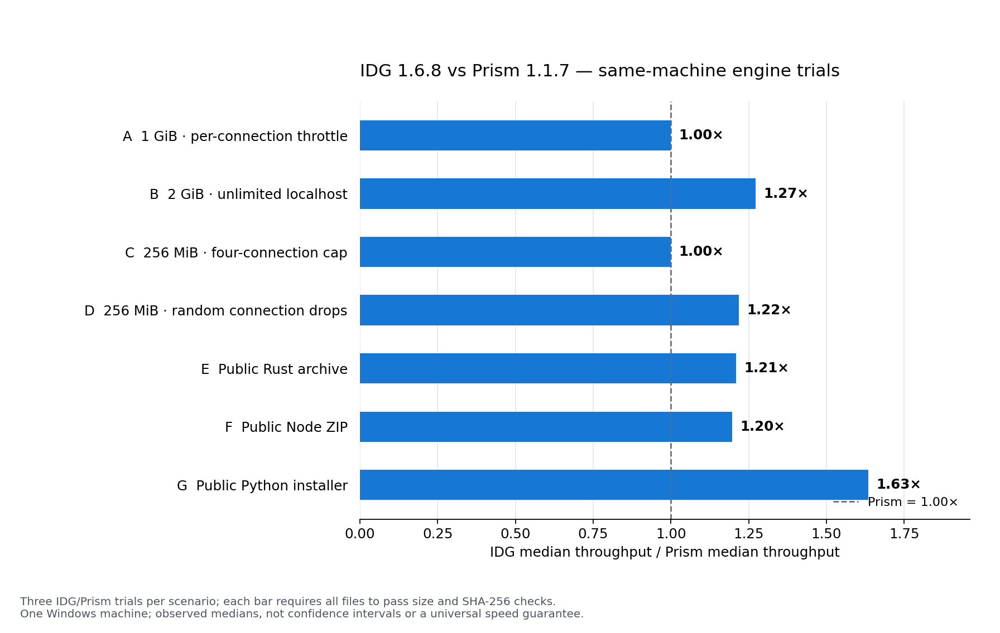

# IDG 1.6.8 same-machine download benchmarks

Measured on **7 November 2026** using the released **v1.6.8 production download
engine** at [777ab94](https://github.com/Mustafa1p/IDG-internet-download-go/commit/777ab94d8b733477acf9dcbd1dddfbe43b94849c), through the thin `idg-get` CLI.
Peer clients are Prism 1.1.7 (`prism-get`), aria2c 1.37.0 and Windows curl 8.21.0.

IDG verified **21/21** attempts; Prism **21/21**, aria2 **18/21**, and curl **12/13**.
IDG's median throughput is 27.2% above Prism on B and 21.9% above Prism on D.
A/C are effectively tied among the parallel clients. Curl has the highest median
throughput on all three public sources. These observations are not a universal
speed claim or a cross-day comparison against older IDG releases.

## Local fixtures

| Scenario | curl (n=1) | aria2c (n=3) | Prism 1.1.7 (n=3) | IDG 1.6.8 (n=3) |
| --- | ---: | ---: | ---: | ---: |
| 1 GiB, 4 MiB/s per connection | 4.00 MiB/s | 63.00 MiB/s | 62.77 MiB/s | 62.79 MiB/s |
| 2 GiB, unlimited localhost | 874.38 MiB/s | 370.69 MiB/s | 1,326.28 MiB/s | 1,687.07 MiB/s |
| 256 MiB, four connections at 2 MiB/s | 2.00 MiB/s | 7.98 MiB/s | 7.99 MiB/s | 7.98 MiB/s |
| 256 MiB, 2% random drops per chunk | Failed (1/1) | Failed (3/3) | 34.49 MiB/s | 42.04 MiB/s |

IDG/Prism/aria2 have three runs each; curl has one reference run per local fixture.
The D failures are aria2 3/3 (exit 1) and curl 1/1 (exit 18). Failed attempts have
no throughput score; their exit codes, partial-file hashes/sizes and logs remain
in the evidence. The partial payloads themselves remain in the local benchmark
work directories rather than this Git repository.

## Public HTTPS files

| Scenario | curl (n=3) | aria2c (n=3) | Prism 1.1.7 (n=3) | IDG 1.6.8 (n=3) |
| --- | ---: | ---: | ---: | ---: |
| 76.2 MiB public Rust archive over HTTPS | 51.52 MiB/s | 43.05 MiB/s | 40.01 MiB/s | 48.39 MiB/s |
| 34.7 MiB official Node ZIP over HTTPS | 48.03 MiB/s | 43.01 MiB/s | 35.70 MiB/s | 42.75 MiB/s |
| 26.9 MiB official Python installer over HTTPS | 32.90 MiB/s | 23.06 MiB/s | 19.49 MiB/s | 31.87 MiB/s |

Every tool has three public runs. Publisher size and SHA-256 checks are required
for every successful download; publisher checksum metadata is checked over HTTPS
before the suite starts. Downloaded executables/archives are never run.



## Method and machine

- Windows 11 build 26300; AMD Ryzen 9 9950X3D, 16 cores / 32 logical processors;
  about 125.6 GiB usable RAM; Samsung 990 PRO 4TB NVMe SSD, NTFS output volume.
  Exact [machine metadata](benchmarks/v1.6.8/machine.json) is retained.
- Both Rust clients use their release builds. Compiler version, executable
  SHA-256 values, production-source hashes and every exact command are recorded
  in the raw results. The IDG CLI shares the desktop's production modules and
  HTTP-client constructor. These are explicit-count engine measurements, rather
  than a measurement of the desktop's Automatic connection setting or GUI.
- Trials run sequentially with cyclic tool order, fresh destinations and fresh
  local servers. No builds or other benchmark downloads ran concurrently. User
  applications were preserved, and OS caches were not forcibly cleared.
- Three rotations do not cover all four tool-order positions. Observed min/max
  values are sample ranges, not confidence intervals. Public-network variation
  remains material, and independent D faults are not paired by seed.

| Scenario | Size | Requested parallel connections | Source policy |
| --- | ---: | ---: | --- |
| A | 1 GiB | 16 | 4 MiB/s per connection; seed 101 |
| B | 2 GiB | 8 | Unlimited localhost; seed 202 |
| C | 256 MiB | 16 | Four active connections, 2 MiB/s each; HTTP 503 for excess; seed 303 |
| D | 256 MiB | 16 | 3 MiB/s each; independent 2% drop probability per server chunk; seed 404 |
| E | 79,909,984 bytes | 16 | Official Rust 1.90.0 Windows compiler archive |
| F | 36,356,854 bytes | 16 | Official Node v24.11.0 Windows ZIP |
| G | 28,160,096 bytes | 16 | Official Python 3.13.0 Windows installer |

Curl uses one connection in every case. Requested counts are ceilings; servers
can admit fewer. A–D use the pinned, unmodified Prism test server. Its deterministic
content hash is printed before timing; its random drop draws are independent.

Timing starts immediately before launching the client and ends after process
exit and an external file-sync barrier. Hash verification is outside that timed
interval for every client. Server startup/reference-hash generation is untimed.
MiB/s is exact bytes / 1,048,576 / durable wall seconds. The chart divides the
IDG median by the Prism median and requires all three trials of both to verify.

Aria2 uses `-xN -sN -k1M --file-allocation=none --disable-ipv6=true`; the IPv6
setting is retained from the original reproducible harness. Curl receives no
additional retry or resume flags. Options and failures describe these measured
invocations, rather than every possible client setup.
Certificate verification stays enabled.

## Raw evidence and resource counters

- [Local raw trials](benchmarks/v1.6.8/local/results.json), [summary](benchmarks/v1.6.8/local/summary.json), [time/range details](benchmarks/v1.6.8/local/detail.md), [client resources](benchmarks/v1.6.8/local/resources.md).
- [Public raw trials](benchmarks/v1.6.8/public/results.json), [summary](benchmarks/v1.6.8/public/summary.json), [time/range details](benchmarks/v1.6.8/public/detail.md), [client resources](benchmarks/v1.6.8/public/resources.md).
- [Local logs/source archive](benchmarks/v1.6.8/local/evidence.zip) and [SHA-256 manifest](benchmarks/v1.6.8/local/evidence.json); [public archive](benchmarks/v1.6.8/public/evidence.zip) and [manifest](benchmarks/v1.6.8/public/evidence.json). Extract each archive into its report directory to restore the relative log/source paths in its raw results.
- Each evidence archive also contains `original-results.json`, preserving the original raw bytes. The readable `results.json` has normalized line endings with identical JSON values.
- [Combined machine-readable summary](benchmarks/v1.6.8/summary.json). Resource counters cover only the client process, excluding the test server and descendants. Missing counters are not zeroes; CPU cycles are hardware-dependent counts and are not converted into elapsed time.
- The [30 October IDG 1.6.1 report](benchmarks-1.6.1.md) and its original raw data remain available. They are a separate cohort.

## Reproduce on Windows

Use a clean checkout of tag `v1.6.8`, Python 3.11+, the pinned Prism reference and
aria2c 1.37.0. No peer executable is bundled with IDG. Matplotlib is needed only
for the optional figures/report generator.

```powershell
git clone https://github.com/FortoGraphy/prism-download-manager.git prism-reference
git -C prism-reference checkout c25f3c795c962323982effcb0220fcbbe75ee2a3
cargo build --locked --release --manifest-path prism-reference/Cargo.toml -p prism-engine --example prism-get
cargo build --locked --release --manifest-path prism-reference/Cargo.toml -p prism-testserver --bin prism-testserver
cargo build --locked --release --example idg-get
python scripts/benchmark.py --prism-root prism-reference --aria2 C:/tools/aria2c.exe --output target/v168-local-results.json --scenarios A B C D --tools IDG Prism aria2c curl --repeats 3 --curl-repeats 1
python scripts/benchmark.py --prism-root prism-reference --aria2 C:/tools/aria2c.exe --output target/v168-public-results.json --scenarios E F G --tools IDG Prism aria2c curl --repeats 3
python scripts/benchmark_report.py target/v168-local-results.json --output target/v168-local-report --scenarios A B C D --idg-label 'IDG 1.6.8'
python scripts/benchmark_report.py target/v168-public-results.json --output target/v168-public-report --scenarios E F G --idg-label 'IDG 1.6.8'
```

The harness requires fresh result paths and preserves failed payloads. Successful
payloads are removed only after exact verification. Desktop preferences, browser
profiles, user downloads and the published v1.6.8 release assets are unchanged.
