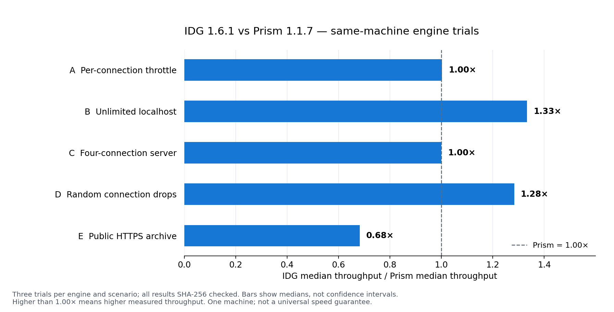

# Same-machine download benchmarks

Measured on 30 October 2026 using IDG's **production download modules**, through
the thin `idg-get` example, against Prism 1.1.7's `prism-get`, aria2c 1.37.0 and
Windows curl 8.21.0. This follows [Prism's published engine-CLI approach](https://github.com/FortoGraphy/prism-download-manager/blob/c25f3c795c962323982effcb0220fcbbe75ee2a3/docs/benchmarks.md).

The 2 GiB unlimited-localhost scenario measured **1,716 MiB/s median for IDG**
and **1,287 MiB/s for Prism**: **33.3% higher throughput** in this test. This is a
same-machine engine result, not a promise that every internet download is faster.
With random drops, IDG measured **38.85 MiB/s** versus Prism's **30.27 MiB/s**
median (**28.3% higher**); both completed all three trials. A/C were effectively
tied. On the public HTTPS archive, Prism was faster: **23.62 MiB/s versus IDG's
16.14 MiB/s**. That counter-result is retained in the table and chart.

## Results

| Scenario | curl (n=1) | aria2c (n=3) | Prism 1.1.7 (n=3) | IDG 1.6.1 (n=3) |
| --- | ---: | ---: | ---: | ---: |
| 1 GiB, 4 MiB/s per connection | 4.00 MiB/s | 63.04 MiB/s | 62.78 MiB/s | 62.96 MiB/s |
| 2 GiB, unlimited localhost | 1,025.42 MiB/s | 377.33 MiB/s | 1,287.33 MiB/s | 1,716.14 MiB/s |
| 256 MiB, four connections at 2 MiB/s | 2.00 MiB/s | 7.98 MiB/s | 7.99 MiB/s | 7.99 MiB/s |
| 256 MiB, 2% random drops per chunk | Failed (1/1) | Failed (3/3) | 30.27 MiB/s | 38.85 MiB/s |
| 76.2 MiB public Rust archive over HTTPS | 52.48 MiB/s | 39.51 MiB/s | 23.62 MiB/s | 16.14 MiB/s |

Values are medians of **three trials** for IDG, Prism and aria2c; curl has **one
reference trial** per scenario. Failed transfers have no throughput score. All
successful transfers require an exact file size and a matching SHA-256.



| Scenario | Tool | Verified / attempted | Median seconds | Median MiB/s | Observed min–max MiB/s |
| --- | --- | ---: | ---: | ---: | ---: |
| A | curl | 1 / 1 | 256.027 | 4.00 | 4.00–4.00 |
| A | aria2c | 3 / 3 | 16.244 | 63.04 | 63.01–63.04 |
| A | Prism | 3 / 3 | 16.312 | 62.78 | 62.67–62.81 |
| A | IDG | 3 / 3 | 16.265 | 62.96 | 62.95–63.02 |
| B | curl | 1 / 1 | 1.997 | 1025.42 | 1025.42–1025.42 |
| B | aria2c | 3 / 3 | 5.428 | 377.33 | 345.84–378.16 |
| B | Prism | 3 / 3 | 1.591 | 1287.33 | 1238.37–1313.78 |
| B | IDG | 3 / 3 | 1.193 | 1716.14 | 1555.19–1813.61 |
| C | curl | 1 / 1 | 128.026 | 2.00 | 2.00–2.00 |
| C | aria2c | 3 / 3 | 32.083 | 7.98 | 7.98–7.98 |
| C | Prism | 3 / 3 | 32.040 | 7.99 | 7.99–7.99 |
| C | IDG | 3 / 3 | 32.032 | 7.99 | 7.99–7.99 |
| D | curl | 0 / 1 | — | — | — |
| D | aria2c | 0 / 3 | — | — | — |
| D | Prism | 3 / 3 | 8.457 | 30.27 | 24.03–36.19 |
| D | IDG | 3 / 3 | 6.590 | 38.85 | 37.86–39.02 |
| E | curl | 1 / 1 | 1.452 | 52.48 | 52.48–52.48 |
| E | aria2c | 3 / 3 | 1.929 | 39.51 | 36.58–40.08 |
| E | Prism | 3 / 3 | 3.227 | 23.62 | 21.27–24.88 |
| E | IDG | 3 / 3 | 4.723 | 16.14 | 15.27–17.91 |

Min–max values describe the observed samples, **not confidence intervals**. The
complete [raw trials](benchmarks/results.json), [machine-readable summary](benchmarks/summary.json)
and per-trial tool/server logs are retained beside this report.

## Machine and builds

- Windows 11 Pro, build 26300; AMD Ryzen 9 9950X3D, 32 logical processors;
  approximately 125.6 GiB usable RAM; Samsung 990 PRO NVMe SSD, NTFS output volume.
- IDG engine source: [`a615632`](https://github.com/Mustafa1p/IDG-internet-download-go/commit/a615632ae84e99b3485d323984fd2db7cd923d5c).
  The final report/release commit may add documentation; the tested production
  file hashes are recorded in the raw results.
- Prism source: [`c25f3c7`](https://github.com/FortoGraphy/prism-download-manager/commit/c25f3c795c962323982effcb0220fcbbe75ee2a3),
  version 1.1.7, built without changing its engine or benchmark server.
- Both Rust clients use their own release profiles, optimization level 3 and
  thin LTO. Compiler version, executable SHA-256 values and exact commands are in
  the raw results. IDG's desktop and CLI share the same HTTP-client constructor.
- Downloads run **sequentially**, with cyclic tool order, a fresh destination and
  a fresh local server per trial. Background user applications were preserved;
  the OS page cache was not forcibly cleared. These are not cold-cache results.

## Workloads and verification

A–D use Prism's unmodified `prism-testserver`. It generates deterministic bytes
from a seed and absolute offset, and prints the reference SHA-256 before timing.

| Scenario | Size | Requested connections | Server policy |
| --- | ---: | ---: | --- |
| A | 1 GiB | 16 | 4 MiB/s per connection; seed 101 |
| B | 2 GiB | 8 | Unlimited localhost; seed 202 |
| C | 256 MiB | 16 | Four TCP connections maximum, HTTP 503 for extras, 2 MiB/s each; seed 303 |
| D | 256 MiB | 16 | 3 MiB/s each; independent 2% random drop probability per server chunk; seed 404 |
| E | 79,909,984 bytes | 16 | Fixed public HTTPS archive; source/CDN/link conditions vary |

Curl always uses one connection. Identical byte content and server policies do
not imply identical random drop sequences: D deliberately uses independent
fault draws. Three trials are a small sample, especially for random faults and
external internet traffic.

E uses the [official Rust 1.90.0 Windows compiler archive](https://static.rust-lang.org/dist/rustc-1.90.0-x86_64-pc-windows-msvc.tar.xz)
and its [publisher-provided SHA-256](https://static.rust-lang.org/dist/rustc-1.90.0-x86_64-pc-windows-msvc.tar.xz.sha256):

```text
a18b3912905f154c34a7572954dda9e9849ac6411a1e02fa390bf742f918fbcb
```

This internet file differs from Prism's older published Debian test. All **new**
E measurements use the same Rust archive. Do not compare these absolute numbers
to Prism's older machine or infer an independently measured line speed.

### Timing

The stopwatch starts immediately before launching the downloader and stops after
it exits **and the harness fsyncs the resulting file**. Process-only wall times
are also retained. SHA-256 verification happens **outside** that timed interval,
equally for all tools. Server startup and reference-hash generation are untimed.

```text
MiB/s = exact file bytes / 1,048,576 / durable wall seconds
IDG throughput ratio = median IDG MiB/s / median Prism MiB/s
Throughput increase (%) = (ratio - 1) × 100
```

This extra fsync normalizes file durability across clients; it is not identical
to the process-only timing in Prism's shell script. Range/validator checks and
completion synchronization remain enabled; the harness applies SHA-256 equally.

### Options and limitations

Aria2 uses `-xN -sN -k1M --file-allocation=none` and its default retry policy,
plus `--disable-ipv6=true`: its stock Windows binary encountered an unreachable
IPv6 route on this machine. Curl and both Rust clients connected successfully
using their normal address selection. Certificate validation remains enabled.
Different aria2 retry/configuration options are outside this comparison.

The chart compares engine CLI throughput, not desktop frame rate, memory use,
startup time, cross-platform support or feature completeness. A/C intentionally
impose server limits that no downloader can materially exceed. Internet results
depend on the source and network. This report does not establish universal
superiority or statistical significance from three trials.

## What changed in IDG 1.6.1

An [initial diagnostic with the 1.6.0 engine](benchmarks/baseline-1.6.0.json)
measured about 1,101 MiB/s for B and failed C and D. That was **one exploratory trial per tool**, not the final
three-trial comparison. The optimization work addressed the observed gaps:

- One bounded writer thread performs offset writes; workers reuse coalesced
  buffers and advance retry positions only after a disk acknowledgement.
- NTFS/ReFS sparse setup avoids zero-filling unwritten gaps before parallel
  ranges arrive. Unsupported filesystems fall back to regular allocation.
- HTTP 429/503 refusals retire connection slots while preserving at least one;
  remaining ranges queue behind accepted connections.
- Received bytes in a range-validated short buffer survive a broken stream. Productive
  reconnects reset the consecutive-failure budget; stalled retries back off.
- Completion still requires a file-sync barrier. Filename protection,
  Content-Range/validator checks, cancellation and shared rate limits remain.

Implementation references: [Windows sparse-file control](https://learn.microsoft.com/en-us/windows/win32/api/winioctl/ni-winioctl-fsctl_set_sparse)
and [Rust Windows offset writes](https://doc.rust-lang.org/std/os/windows/fs/trait.FileExt.html#tymethod.seek_write).
Local and Windows CI regressions cover exact concurrent output, disk failures,
server connection caps, repeated short-stream interruptions, pause/resume,
cancellation, rate limiting and authenticated one-shot exports.

## Reproduce on Windows

Use a separate checkout for Prism; no peer executable is bundled with IDG.
The harness uses Python 3.11+ and its standard library. The optional chart/report
generator additionally requires Matplotlib (`python -m pip install matplotlib`).

```powershell
git clone https://github.com/FortoGraphy/prism-download-manager.git prism-reference
git -C prism-reference checkout c25f3c795c962323982effcb0220fcbbe75ee2a3
cargo build --locked --release --manifest-path prism-reference/Cargo.toml -p prism-engine --example prism-get
cargo build --locked --release --manifest-path prism-reference/Cargo.toml -p prism-testserver --bin prism-testserver
cargo build --locked --release --example idg-get
# Download aria2c 1.37.0 from the official aria2/aria2 GitHub release.
python scripts/benchmark.py --prism-root prism-reference --aria2 C:/tools/aria2c.exe --output target/my-benchmark.json --scenarios A B C D E --repeats 3 --curl-repeats 1
python scripts/benchmark_report.py target/my-benchmark.json --output target/my-benchmark-report
```

The harness never overwrites a previous result file, never touches desktop
preferences, and removes only its own generated payloads after checking them.
Keep the JSON and logs even if a tool fails. To give curl the same sample count,
omit `--curl-repeats 1`; its throttled reference runs will take substantially longer.

## Verification status

Independent arithmetic checks verified all 50 distinct trials, exact success
counts, file sizes/hashes, timing denominators, medians, reported percentage
changes and the presence of every retained tool log. The tested download-source
hashes match the production sources included in the release. There were 46
verified successful transfers and four failures: curl's single D attempt and
all three aria2c D attempts. IDG and Prism each completed all 15 trials.

Both Windows architectures passed warning-free checks and 53 Rust regressions
each (nine external/tool-dependent tests excluded by default). GitHub CI passed
for the tested engine commit; the current app also passed 48 real desktop
interaction checks. The benchmark chart was inspected against the calculated
ratios, with the zero baseline, Prism reference and slower E result visible.
