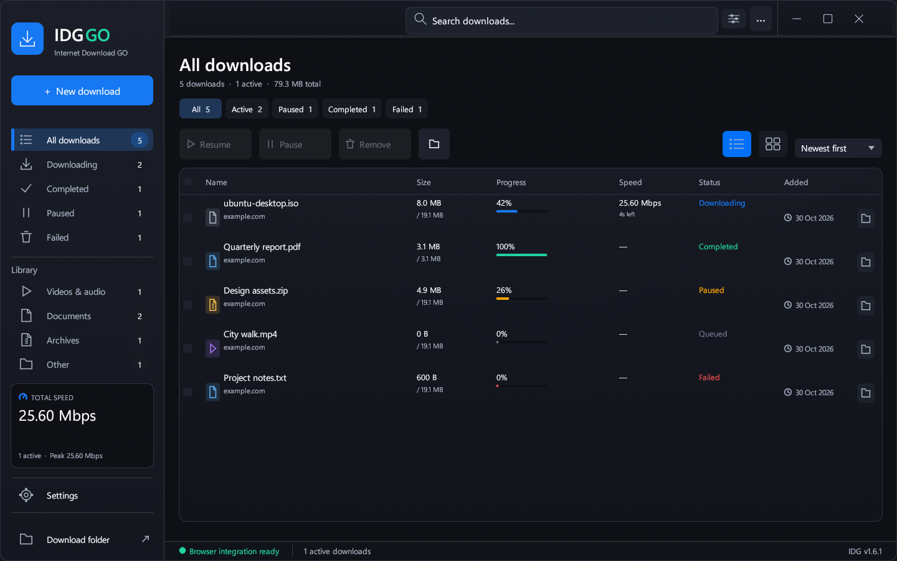
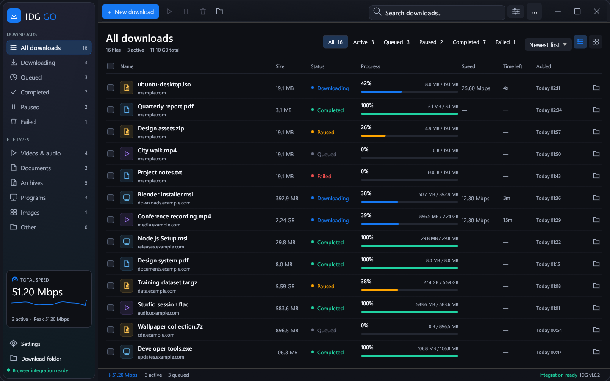

# Desktop refresh — v1.6.2

The library now uses one command bar, grouped navigation, aligned transfer columns
and full-width progress bars. Filenames remain 14 logical points; the improvement
comes from layout and hierarchy. New windows start at 1360 × 860 logical points,
while saved window sizes remain respected.

| Before v1.6.1 | After v1.6.2 |
| --- | --- |
| Stacked commands and filters | One command bar; title, filters and view controls share a band when space permits |
| Larger sidebar branding and loosely grouped entries | 232-point sidebar on wide windows, 196-point sidebar on compact windows, grouped download and file-type navigation |
| Short fixed-width progress bars | Progress columns adapt to available width and use consistent status colors |
| Queued items included under Downloading | Separate Queued navigation and accurate active counts |
| Filename search | Filename and source-host search |
| General file-type categories | Dedicated Programs and Images categories |
| Long inspector names could crowd actions | Truncated name with tooltip and reserved space for action buttons |

## Before

## After

Both screenshots show the actual Rust/egui app in isolated development preview
mode. The new screenshot contains 16 sample downloads; its illustrative speed
trace is compiled only into debug builds. Production speed samples come from
actual transfers. Preview rows do not start downloads or modify user files.

## Verification

- 54 actual-app interaction checks: navigation, filters, filename selection,
  source search, bulk actions, details, Settings, shortcuts and window controls.
- 27 actual-app render cases, including 800 × 500 minimum size, list/grid,
  selected files, long names, dialogs and 125%, 150%, 200% rendering scales.
  Each case asserts Settings, Download folder and the last category stay inside
  the window; these checks caught and prevented sidebar clipping at short heights.
- Native Windows monitor moves, resize, maximize and restore across three
  connected monitors, including 100% and 125% native DPI.
- Rust regression tests: 53 passed, 9 intentionally ignored external/runtime cases.
- Warning-free Clippy for x64 and x86; package-version consistency checks.

Run `python tests/fluent-preview.py`, `python tests/fluent-interaction.py` and
`python tests/multi-monitor-smoke.py` after building the debug app.

The transfer engine sources retain the exact hashes recorded with the v1.6.1
benchmark dataset. This UI release does not claim new throughput measurements.
