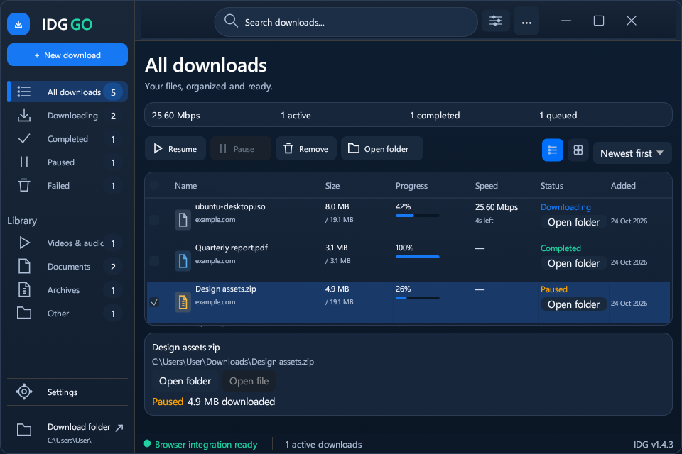

# IDG Windows 11 Fluent redesign report

## Implementation

Implemented directly in the existing Rust 2024 / eframe-egui 0.29 desktop app.
There is no replacement frontend, webview, external UI service or generated mockup.
The HTTP/media download engine and browser/native-host protocols are retained.
The only added dependency capability is `Win32_Graphics_Dwm` on the existing
windows-sys dependency, for Windows 11 corner preference. No new package was added.

The interface now contains the reference's blue sidebar and branding, real search
and category filters, custom title bar with native window commands, four real
statistic cards and measured speed history, bulk command toolbar, seven-column
checkbox table, list/grid views, sorting, a local vector folder empty state and
footer. Settings, Add download/media choices, details, update notices and removal
confirmation follow the same palette and typography. All visible actions are
mapped in [ui-navigation.md](ui-navigation.md).

## Files

- `src/app.rs`: shared colors/typography, application layout, responsive shell,
  consistent dialogs, state integration and minimized-size guard.
- `src/app/library.rs`: navigation, statistics, speed history, bulk selection and
  actions, list/grid, table, vector illustration, details and status.
- `src/app/shell.rs`: search/filter/menu, shortcuts, draggable title bar, native
  minimize/restore/close. The later locked-window refresh disables production resize/maximize, now fixes the size to 960 x 640 logical pixels (monitor capped), and adds x86 packages.
- `src/app/settings.rs`: Fluent settings cards, inputs, toggles, save/reset controls
  and isolated real-app screenshot capture.
- `src/app/preview_test.rs`: development-only actual-control interaction checks.
- `src/desktop.rs`, `src/main.rs`, `Cargo.toml`: default size, undecorated native
  window, DWM corners, reduced-motion preference and preview entry point.
- `src/download/engine.rs`: test-only controlled pause/resume/cancellation coverage;
  production engine code is unchanged.
- `tests/fluent-preview.py`, `tests/fluent-interaction.py`: reproducible render and
  interaction runners; existing extension, signing, updater and Rust tests remain.
- `README.md`, `CHANGELOG.md`, `docs/release-notes.md`, screenshot PNGs and QA/route
  reports: updated product instructions, actual app captures and evidence.
- `installer/package.py`, `installer/setup.iss`: bundle documentation and screenshot assets so README links also work in installed and portable packages.
- `.github/workflows/release.yml`, `.gitignore`: Cargo feature-aware cache key and
  ignore generated distribution checksums.

## Reference comparison

Reviewed actual application captures against the supplied screenshot, iterating
layout and repainting the real app after each correction. At the 1540×930
reference-size capture, the sidebar is 320 points, title bar 72 points, main
padding 24 points and statistic cards 104 points high. These closely follow the
reference's approximate 324-pixel sidebar, 72-pixel title bar and 104-pixel cards
when its surrounding desktop margin is excluded. The table top, toolbar, header,
sidebar rail, blue controls and footer follow the reference's arrangement.




The reference image was available in the conversation rather than as a local
image artifact, so comparison was visual and measurement-based; no automated
pixel-difference percentage is claimed. Materials are gradient/vector treatments
rather than actual Mica/Acrylic blur. The folder illustration is a scalable local
vector interpretation rather than a pixel-identical copy of the reference's
3D artwork. Short layouts intentionally compact statistics and details.

## Verification

- Rust regression tests: **30 passed**, 0 failed, 3 live-network tests ignored.
- Extension protocol tests: **23 passed**.
- Signing-script tests: **10 mock-signature scenarios passed**; release is unsigned.
- Actual Rust application rendering: **19 cases passed**, covering 800×500 through
  1920×1080 and 100/125/150/200% rendering scales, empty/populated list, grid,
  selection/details, Settings, Add download, update popup and removal confirmation.
- Actual app interaction harness: **33 checks passed**, including all nine
  categories, keyboard routes, list/grid, selection, bulk actions, removal
  cancellation, sorting, search and observed native minimize/maximize/restore.
- Formatting and Clippy with warnings denied passed.

Controlled loopback HTTP tests verified pause/resume with exact **262,163 bytes**,
paused progress stabilization, cancellation without file deletion or hanging,
authenticated 10,003-byte content, EML/ZIP exports, EOF streaming, and 64 MiB range
and fallback fixtures. These use temporary files; the installed user app and
its downloads were left running and untouched.

See [fluent-qa.md](fluent-qa.md), [render metadata](fluent-render-matrix.json) and
[interaction evidence](fluent-interaction-results.json) for scope and results.

## Limits

Actual Windows display-setting changes and cross-monitor DPI transitions,
manual screen-reader testing, live authenticated browser/media sessions and
cold-start/tray smoke against the installed instance were not performed. The
custom title bar does not provide Windows Snap Layouts' maximize-hover flyout.
The real folder picker remains OS-native. Download history now persists without credentials. Interrupted workers are not restored after exit; entries remain visible with an explanation. Browser default-folder changes take effect after restarting the existing server. The compact refresh adds build-aware same-version updates, browser-handoff navigation and the tested installer force-close fallback.

## Build and run

```powershell
cargo run --bin IDG
cargo build --locked --release --bins
python tests/fluent-preview.py
python tests/fluent-interaction.py
./installer/build-installer.ps1
python installer/package.py v1.4.3
```

The graphical test runners require `cargo build --bin IDG` first and an interactive
Windows desktop. Their preview data is isolated and is not production download
history. Future real releases use normal engine measurements and release API data.

## Git and release

Implementation commit: [315b84b](https://github.com/Mustafa1p/IDG-internet-download-go/commit/315b84b).
Work was isolated on `redesign/windows-11-fluent` and integrated into `main` for
release verification. The Windows packages retain **v1.4.3**, as requested.
The refreshed release notes identify the final package source revision. Existing
1.4.3 installations need the refreshed installer once because equal versions do
not trigger an automatic update. The existing release tag is preserved, and its
notes link to the refreshed source commit. Packages remain explicitly unsigned.
