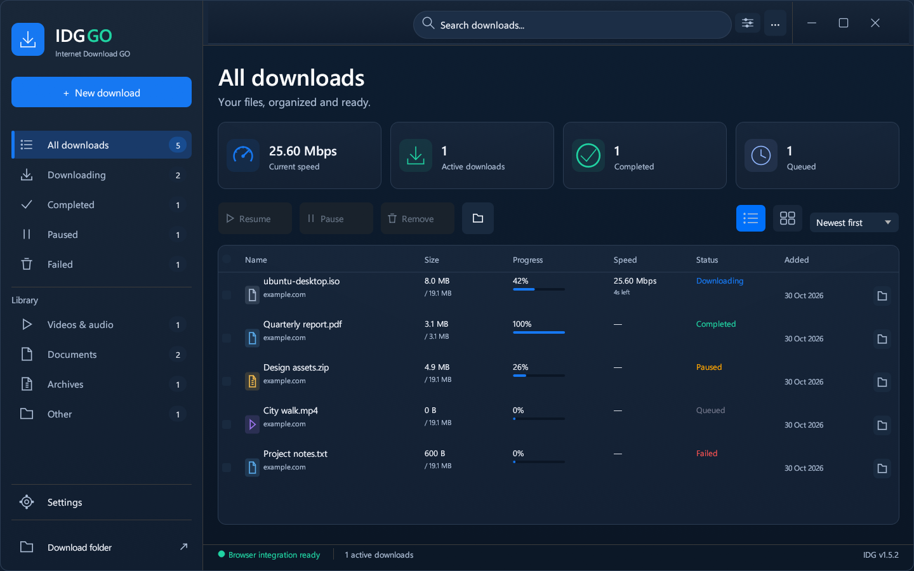
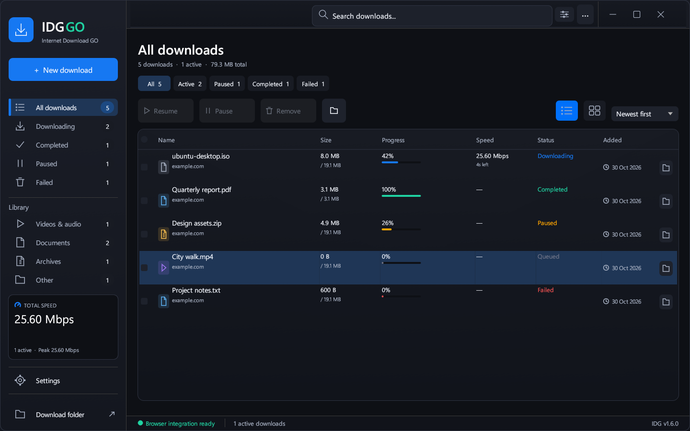

# Prism comparison and IDG 1.6.0

Reference reviewed: FortoGraphy/prism-download-manager at
`c25f3c795c962323982effcb0220fcbbe75ee2a3` (30 October 2026), including release
notes through 1.1.7, HTTP fetcher/resume/segmented engine, React design tokens,
main-window, details and settings screenshots. Prism is MIT licensed.

## Design lock before implementation

Primary target: Prism's `design/screens/app-main-dark.png`. Preserve its neutral
dark canvas, distinct navigation rail, quiet borders, transfer-first table,
status filters, state-colored progress and persistent speed overview. Adapt to
IDG's blue identity and native egui controls. Secondary reference: IDG's existing
Settings tabs, keyboard shortcuts and browser confirmation workflow. Local
Refero craft guidance supplies focus, labels and control-state rules; the live
Refero service returned NO_SUBSCRIPTION.

| Decision | Source and role | IDG adaptation |
| --- | --- | --- |
| Neutral dark surfaces | Prism main window; surfaces, not status | Charcoal canvas, raised sidebar, thin borders |
| Blue accent | Existing IDG identity; actions/selection | Keep blue primary button; green/amber/red convey status |
| Roomier default | User explicitly requested larger UI | 1280 × 800 logical points; minimum remains 800 × 500 |
| Transfer-first hierarchy | Prism main window | Replace oversized statistics with summary and status tabs |
| Speed overview | Prism sidebar speed pane | Actual bounded transfer samples, no invented traffic |
| Detail inspector | Prism details + existing IDG selection | Selected file, destination, bytes, connections and error |
| Readable rows | User request + local craft guidance | 14 pt filename at normal size; full-name tooltips |

No Prism logos, fonts, screenshots or implementation code are shipped in the
app. The implementation is written for IDG; comparisons reference Prism rather
than claiming its benchmark results.

## Source comparison

Prism is ahead in cross-platform support, light/dark themes, localization,
FTP/torrents, queue scheduling, dynamic segmentation, crash-resume checkpoints,
server validator checks and Hugging Face model downloads. These are substantial
systems, not fixes that can be safely pasted into IDG's different architecture.

IDG already has up to 32 connections, a native Rust/egui UI without a webview,
Windows x64/x86 packaging, one-shot authenticated POST/mail exports, browser
confirmation and optional original-service music accounts. This review does
not establish that either application is faster or uses less memory.

Prism's recent applicable reliability patterns: prevent robot-check HTML from
being saved as a binary; require correct response ranges; validate source
identity when reconnecting; publish completion only after durable output.
IDG 1.6.0 implements these with local regression coverage. Persistent crash
resume and dynamic work stealing remain future work and are not advertised.
Direct HTTP downloads also reserve their destination atomically; an existing
`file.zip` is preserved and another download becomes `file (1).zip`.

## Before / after evidence

Captured from the actual IDG app at the same 1440 × 900 viewport with identical
isolated fixture downloads. The fixture rows do not transfer data.

| Before | After |
| --- | --- |
|  |  |

| Area | Before | After |
| --- | --- | --- |
| New-window size | 960 × 640 | 1280 × 800 logical points; saved sizes respected |
| Library header | Oversized four-card summary | Counts, total size and actionable status tabs |
| Surfaces | Saturated navy throughout | Neutral dark hierarchy with blue actions |
| Progress | Blue for every state | Green complete, amber paused, red failed |
| Selected file | No inspector in working source | Destination, bytes, connections, actions and error |
| Duplicate HTTP filename | Existing file truncated | Atomically numbered destination |
| Partial responses | HTTP 206 accepted without exact range | Requested offset/end/total and validators checked |
| Unexpected HTML | Could be saved under binary names | Browser guidance before body writes |
| Completion | Buffered writes flushed | Flush followed by disk sync |

## Validation

- Rust formatting and warning-free Clippy: x64 and x86.
- Rust regressions: 48 passed on each architecture; 9 external/tool-dependent
  tests excluded by default. The optional worker's verified-output/cancellation
  protocol was additionally run and passed on x64.
- Extension unit regressions: 56 passed. Music bridge: 18 passed. Version/package
  validation: 2 passed. Signing failure boundaries: 10 scenarios passed.
- Seven real Edge browser suites: forms, Spotify page/rows/library/playback,
  linkless page state, and YouTube/X/Instagram/TikTok overlay visibility passed.
- Actual desktop: 25 render scenarios (800 × 500 through 1920 × 1080, scaling
  through 200%) and an additional 1440 × 900 before/after capture; 48 rendered
  control interactions passed, including new filter tabs and closing details.
- Native DPI: 14 transitions/resize/maximize/restore checks across three connected
  monitors passed at 96/120 DPI. The test now expects the intended work-area cap
  when moving a 1100-point window to the 1080-pixel portrait display.
- Isolated installer-close fixture passed; it did not close the user's running app.

The optional music services were not retested against live subscription accounts.
Full Spotify audio remains unverified. This is a targeted comparison and change
review, not an exhaustive repository audit or performance benchmark.
